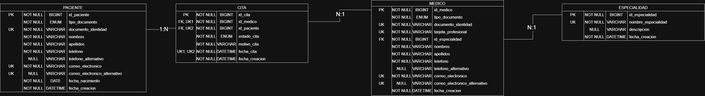

# Sistema de Gestión de Citas Médicas

(Una o dos líneas: qué es y qué problema resuelve)

## 🚧 Estado
En desarrollo. (Qué fase va)

## 🛠️ Tecnologías
- ...

## 🗄️ Modelo de datos

## ▶️ Cómo ejecutarlo
1. Crear la base de datos con `database/schema.sql`
2. Definir las variables de entorno `DB_USERNAME` y `DB_PASSWORD`
3. ...
